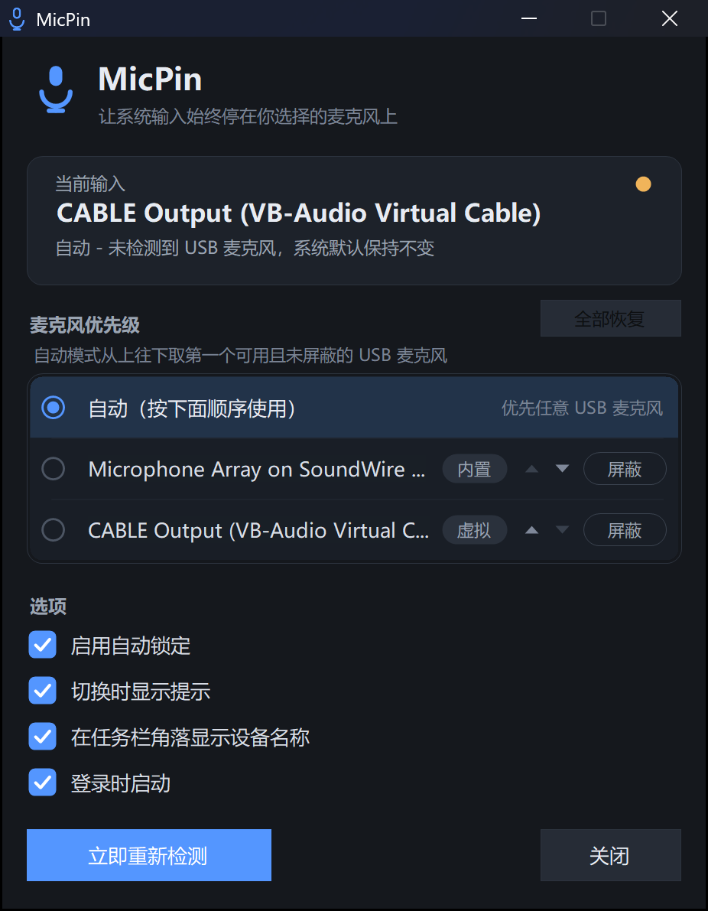
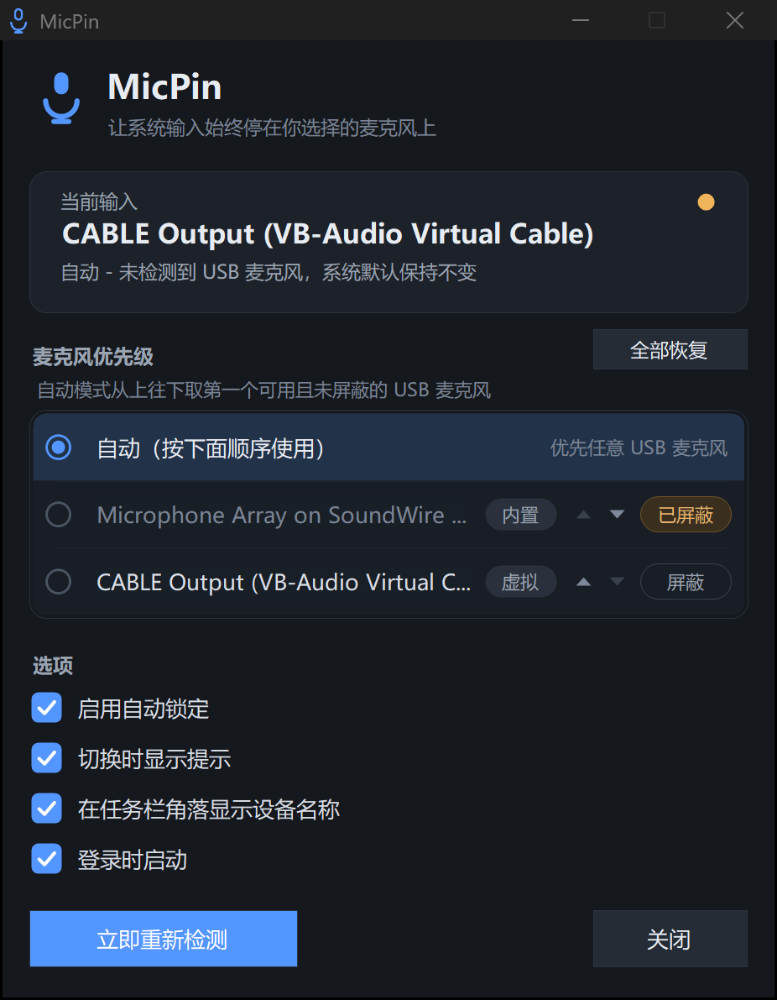

# MicPin for Windows

让 Windows 的默认输入设备始终停在你指定的麦克风上：插上 USB 麦克风就立刻抢到系统默认，
戴蓝牙耳机听歌时不会再被耳机麦克风顶掉。

> 从 macOS 版 MicPin（菜单栏麦克风守护）移植，行为对齐，界面按 Windows 习惯重做。
> 纯 .NET Framework 4.8 + WinForms + Core Audio COM 直调，单文件 exe，无需安装运行时。
> 原始分辨率高、150%/200% 缩放的高分屏下按原生像素渲染（PerMonitorV2）。

---

## 截图

| 主界面（深色） | 屏蔽了一个麦克风 |
| --- | --- |
|  |  |

---

## 它能解决什么

Windows 的默认输入设备经常被“最后插上的那个设备”或蓝牙耳机抢走：

- 插上 USB 麦克风，系统输入却还停在内置麦克风阵列上；
- 戴 AirPods 听歌，输入被切到 Hands-Free（通话）麦克风，音质塌掉；
- 拔掉 USB 麦克风后，系统掉到内置麦，而你想要它保持原来的选择；
- 同时有多个 USB 麦克风时，希望能指定“先用哪个、后用哪个”。

MicPin 常驻托盘，盯着设备插拔与默认设备变更，把默认输入强制锁到你指定的设备；
同时提供 **优先级排序** 和 **临时屏蔽**，让多麦克风场景可控。

## 核心特性

- **自动模式**：按你排好的顺序，取第一个“在线且未屏蔽的 USB 麦克风”设为默认输入。
  内置、蓝牙、虚拟声卡永远不会被自动选中。
- **锁定模式**：指定某个具体设备；它不在线时**保持系统默认不动**，不会退而求其次去抢别的设备。
- **优先级排序**：设备列表里用 ▲▼ 调整顺序，顺序持久化；掉线设备的位置保留，重新插上回到原位。
- **临时屏蔽**：一键屏蔽任意麦克风，自动模式跳过它；屏蔽是会话级的，退出程序即恢复。
- **防打架**：15 秒内切换超过 6 次判定为与其他音频软件抢设备，自动暂停 20 秒。
- **三种托盘状态**：实心麦克风=已锁定，空心=待机（未找到 USB 麦克风），打叉=已暂停。
- **切换提示 HUD**：右上角淡入淡出提示当前麦克风；可选在任务栏角落显示设备名。
- **中英双语**：跟随 Windows 显示语言。
- **深色界面 + 高分屏**：自绘深色主题、PerMonitorV2 DPI 感知、1px 对齐像素。

## 运行要求

| 项 | 要求 |
| --- | --- |
| 系统 | Windows 10 1607+ / Windows 11（x64、ARM64 均可，AnyCPU） |
| 运行时 | .NET Framework 4.8（Win10 1903+ / Win11 自带，无需安装） |
| 权限 | 普通用户即可（默认设备是 per-user 设置，不需要管理员） |
| 网络 | 不需要，程序不联网 |
| 麦克风/辅助功能权限 | 不需要（只读设备列表、改默认设备） |

## 构建

不需要 Visual Studio、不需要 .NET SDK、不需要 NuGet —— 直接用 Windows 自带的 C# 编译器。

```powershell
# 在仓库根目录执行
powershell -NoProfile -ExecutionPolicy Bypass -File .\build.ps1
```

产物：

```
dist\MicPin.exe        # 托盘主程序（约 66 KB，单文件）
dist\MicPinDiag.exe    # 控制台诊断工具（约 20 KB）
dist\micpin.ico        # 构建过程中生成的图标
```

> 编译用的是 `%WINDIR%\Microsoft.NET\Framework64\v4.0.30319\csc.exe`（C# 5 语法）。
> 因此**源码里不能使用字符串插值、`?.`、`nameof`、表达式体成员**等新语法，改动时请注意。

## 安装包

不想手动放 exe 的话，构建一个自包含安装器：

```powershell
powershell -NoProfile -ExecutionPolicy Bypass -File .\build-installer.ps1
```

产物 `dist\MicPinSetup.exe`（约 89 KB），主程序已内嵌其中，单文件即可分发：

| 动作 | 说明 |
| --- | --- |
| 双击运行 | 图形安装向导，可选「登录时启动」「在桌面创建快捷方式」 |
| `MicPinSetup.exe --install` | 静默安装（含登录启动与桌面快捷方式） |
| `MicPinSetup.exe --uninstall` | 静默卸载 |

安装位置与卸载：

- 程序装到 `%LOCALAPPDATA%\Programs\MicPin\`，**per-user，不需要管理员**，不触发 UAC；
- 开始菜单有快捷方式；卸载器是安装目录下的 `Uninstall.exe`；
- 卸载入口：「设置 → 应用 → 已安装的应用 → MicPin」或直接跑 `Uninstall.exe`；
- 卸载会清理安装目录、两个快捷方式、`HKCU\...\Run` 启动项与卸载登记项，
  **保留** `%APPDATA%\MicPin\settings.json`（重装后设置还在）。

## 使用

1. 双击 `dist\MicPinSetup.exe` 安装，或直接双击 `dist\MicPin.exe` 免安装运行，托盘出现麦克风图标。
2. 左键单击或双击托盘图标 → 打开主界面。
3. 在“麦克风优先级”里调整顺序；点设备行左侧圆点即可锁定该设备（再点一次回到自动）。
4. 想临时不用某个麦克风，点该行右侧「屏蔽」；「全部恢复」清空所有屏蔽。
5. 右键托盘图标是功能相同的菜单（含退出）。

## 诊断

```powershell
.\dist\MicPinDiag.exe              # 列出采集端点、三种角色的默认设备、自动模式结果、PolicyConfig 可用性
.\dist\MicPinDiag.exe --set "CABLE"  # 按 id 或名称子串把默认输入切到匹配设备（验证写入链路）
```

## 目录结构

```
MicPinWin/
├─ build.ps1             # 构建主程序（两遍编译以嵌入图标）
├─ build-installer.ps1   # 构建安装包（把主程序嵌成资源）
├─ app.manifest          # PerMonitorV2 DPI 感知、Win10/11 supportedOS
├─ installer/
│  └─ Installer.cs       # 自包含 per-user 安装器 / 卸载器
├─ src/
│  ├─ Program.cs         # 入口、单实例、--write-icon
│  ├─ CoreAudio.cs       # Core Audio COM 互操作 + IPolicyConfig（设置默认设备）
│  ├─ AudioDevices.cs    # 端点枚举/分类/监控/自动选择算法
│  ├─ TrayApp.cs         # 应用上下文：看护循环、排序、屏蔽、托盘菜单
│  ├─ MainForm.cs        # 主界面窗口（自绘 + 布局）
│  ├─ DeviceListBox.cs   # 优先级列表（行内 ▲▼/屏蔽、悬停高亮）
│  ├─ DarkCheck.cs       # 深色自绘复选框
│  ├─ Theme.cs           # 深色调色板
│  ├─ Glyphs.cs          # 程序化绘制图标 + DPI 工具
│  ├─ HudForm.cs         # 切换提示 HUD
│  ├─ PillForm.cs        # 任务栏角落设备名浮标
│  ├─ Settings.cs        # JSON 设置持久化 + 开机启动
│  ├─ Strings.cs         # 中英文案
│  └─ Diag.cs            # 控制台诊断入口
└─ docs/
   ├─ REQUIREMENTS.md    # 需求说明与验收标准
   ├─ SPEC.md            # 技术规格（算法、状态机、UI、DPI、数据格式）
   ├─ HANDOVER.md        # 交接文档（架构、构建、调试、已知限制、路线图）
   └─ images/            # README 截图
```

## 文档索引

- [需求说明](docs/REQUIREMENTS.md)：从 macOS 版继承的行为、Windows 侧新增需求、验收标准。
- [技术规格](docs/SPEC.md)：设备分类算法、看护状态机、排序/屏蔽规则、持久化格式、UI 与 DPI 规格。
- [交接文档](docs/HANDOVER.md)：代码地图、构建流水线、调试方法、已知限制、后续计划。

## 已知限制

- 只改变“系统默认输入设备”，不改变在应用内部单独指定了设备的程序。
- 没有代码签名，首次运行会出现 SmartScreen 警告（选择“仍要运行”）。
- 单实例互斥体作用域为当前登录会话。
- HUD 与浮标固定显示在主屏。
- 设备分类依赖端点枚举器名称与虚拟声卡关键词，未覆盖到的设备会落到 `Other`，不会被自动选中。

## License

仓库尚未附带许可证文件。发布前请按需补充 `LICENSE`（MIT / Apache-2.0 等）。
